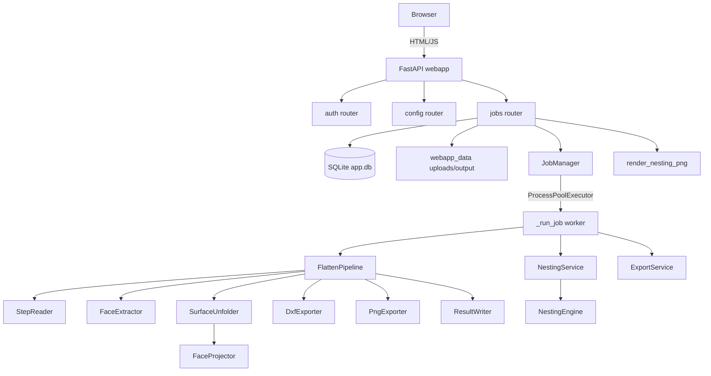
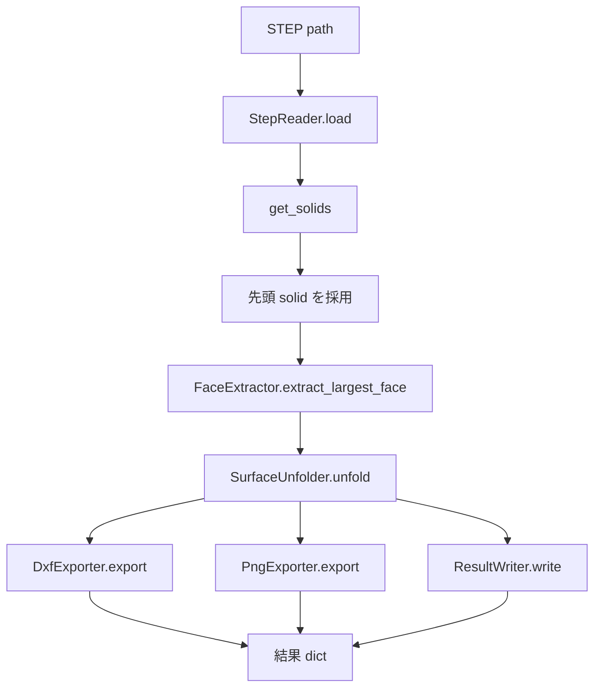

# NetsingTool 詳細仕様書

作成日: 2026-09-03  
対象バージョン: 現行ワークスペース実装

## 1. 目的

NetsingTool は、SolidWorks から出力された STEP ファイルを読み込み、断熱材部品の代表面を平面化し、加工・確認・記録に必要な DXF、PNG、JSON、Excel、ネスティング配置図を生成する社内向け Web アプリケーションである。

主な目的は次の通り。

- STEP 形式の 3D 部品から、最大面積の面を抽出する。
- 抽出面を XY 平面へ展開し、外周と穴加工を 2D ポリゴンとして保持する。
- 単一部品について DXF、PNG、JSON を生成する。
- 複数部品と数量 BOM を受け取り、定尺シート上の配置案を複数生成する。
- 穴加工を考慮したネット面積で歩留まりを算出する。
- Web ブラウザ上でログイン、アップロード、ジョブ実行、進捗確認、候補選択、結果ダウンロードを行えるようにする。

本仕様書は、ジュニアエンジニアが同等のアプリケーションを再実装できる粒度で、機能要件、データ構造、処理フロー、アルゴリズム、API、成果物、テスト観点を定義する。

## 2. システム前提

### 2.1 利用環境

| 項目 | 仕様 |
|---|---|
| 想定 OS | Windows Server / Windows 11 64bit |
| 利用形態 | 社内 LAN 限定、少人数利用 |
| Python | 3.12 以上 |
| Web フレームワーク | FastAPI |
| CAD 読み込み | CadQuery / OCP / OpenCascade |
| DB | SQLite |
| フロントエンド | Jinja2 テンプレート + 素の JavaScript + CSS |
| 認証 | 事前登録ユーザーによるログイン。自己登録 UI は提供しない |

### 2.2 主要依存ライブラリ

| ライブラリ | 用途 |
|---|---|
| cadquery | STEP 読み込み、OCCT 形状操作 |
| numpy | ベクトル・行列計算 |
| scipy | LSCM / ARAP の疎行列計算 |
| ezdxf | DXF R2010 出力 |
| matplotlib | PNG プレビュー、ネスティング配置図レンダリング |
| shapely | ポリゴン妥当化、衝突判定、穴付きポリゴン判定 |
| pyclipper | MinkowskiSum による NFP 計算 |
| openpyxl | summary.xlsx / Excel 出力 |
| fastapi | Web API / ルーティング |
| uvicorn | ASGI サーバー |
| bcrypt | パスワードハッシュ |
| itsdangerous | セッション署名 |
| python-multipart | ファイルアップロード |
| jinja2 | HTML テンプレート |

## 3. 全体アーキテクチャ

NetsingTool は、コア処理層 `src/` と Web アプリ層 `webapp/` に分かれる。



### 3.1 コア処理層

`src/` は Web に依存しない。CLI からも Web ワーカーからも呼び出せる純粋な業務ロジック層である。

| パッケージ | 責務 |
|---|---|
| `src.cad` | STEP ファイルの読み込み |
| `src.flatten` | 最大面の抽出、曲率解析、平面化、穴輪郭抽出 |
| `src.export` | DXF、PNG、JSON、ネスティング配置図の出力 |
| `src.nesting` | 複数部品の配置計算、歩留まり算出 |
| `src.pipeline` | STEP 1 件分の読み込みから成果物生成までの統合 |
| `src.exceptions` | 業務例外 |
| `src.log_setup` | ログ初期化 |

### 3.2 Web アプリ層

`webapp/` は FastAPI アプリケーションであり、ログイン、アップロード、ジョブ管理、ユーザー別設定、ダウンロードを担当する。

| モジュール | 責務 |
|---|---|
| `webapp.main` | FastAPI アプリ生成、DB 初期化、JobManager 起動、テンプレート表示 |
| `webapp.db` | SQLite のスキーマ定義と CRUD |
| `webapp.security` | bcrypt、署名セッション、CSRF トークン、ログインレート制限 |
| `webapp.deps` | 認証済みユーザー取得、CSRF 検証依存関係 |
| `webapp.storage` | ユーザー別アップロード/出力ディレクトリと STEP ファイル検証 |
| `webapp.jobs` | ProcessPoolExecutor によるジョブ実行管理 |
| `webapp.schemas` | Pydantic 入出力スキーマ |
| `webapp.routers.auth` | ログイン、ログアウト、自ユーザー確認 |
| `webapp.routers.config` | ユーザー別設定の取得/保存 |
| `webapp.routers.jobs` | アップロード、ジョブ作成、状態確認、候補取得、レンダー、ダウンロード |
| `webapp.services.nesting_service` | Web 用入力から `NestingEngine` を呼び出し、dict へ変換 |
| `webapp.services.export_service` | Excel 出力、summary.xlsx 追記、DXF コピー |
| `webapp.services.config_service` | CLI/バッチ向け config.json 読み書き |

## 4. ディレクトリ仕様

```text
NetsingTool/
  main.py                    CLI エントリポイント。STEP 1 件を平面化する。
  run_tests.py               pytest 実行ラッパー。cadquery 終了時クラッシュを回避する。
  start_server.bat           Windows 向け Web サーバー起動バッチ。
  config.json                CLI/バッチ向け設定ファイル例。
  README.md                  利用手順・運用手順。
  DESIGN.md                  既存設計メモ。
  SPECIFICATION.md           本仕様書。
  src/                       Web 非依存のコア処理。
  webapp/                    FastAPI Web アプリ。
  tests/                     ユニット・統合テスト。
  docs/TROUBLESHOOTING.md    障害切り分け手順。
  logs/                      ログ出力先。
  output/                    CLI などの成果物出力先。
  webapp_data/               Web アプリの DB、鍵、アップロード、ジョブ成果物。
```

## 5. ユースケース

### 5.1 Web 利用者

1. 管理者が事前にユーザーを作成する。
2. 利用者が `/login` にアクセスし、ユーザー名とパスワードでログインする。
3. トップページ `/` で STEP ファイルを複数選択する。
4. ファイルごとに数量を入力する。
5. 定尺幅、定尺高さ、材料厚み、クリアランスを入力する。
6. 実行ボタンを押す。
7. ブラウザは STEP ファイルをアップロードし、ジョブを作成する。
8. サーバーはバックグラウンドプロセスで各 STEP を平面化し、最後にネスティング候補を生成する。
9. ブラウザは 1.5 秒間隔でジョブ状態をポーリングする。
10. 完了後、候補タブ、配置図、部品別内訳を表示する。
11. 利用者は候補タブを切り替えて、歩留まりと配置図を確認する。
12. 利用者は全成果物 ZIP をダウンロードする。

### 5.2 CLI 利用者

CLI は STEP 1 件の平面化のみを行う。複数部品ネスティング、ログイン、BOM 操作は Web アプリのみ対応する。

```powershell
.venv\Scripts\python.exe main.py path\to\part.step --output-dir output --samples 50
```

CLI は次の情報を標準出力へ表示する。

- 部品面積 `part_area`
- 展開面積 `flattened_area`
- 面積差分率 `area_diff_pct`
- 採用展開手法 `best_method`
- 中立面半径 `neutral_radius`
- 展開誤差率 `error_rate`
- 展開品質 `quality`
- DXF / PNG / JSON 出力先

終了コードは、品質 C の場合 1、それ以外は 0 とする。

## 6. 認証・認可仕様

### 6.1 ユーザー作成

自己登録 UI は提供しない。管理者が次のコマンドでユーザーを作成する。

```powershell
.venv\Scripts\python.exe -m webapp.scripts.create_user <username>
```

仕様:

- パスワードは対話プロンプトで入力する。
- パスワード確認入力が一致しない場合は作成しない。
- パスワードは 8 文字以上でなければならない。
- 既存ユーザー名は登録できない。
- パスワードは bcrypt でハッシュ化して DB に保存する。
- bcrypt の制約により、パスワードは UTF-8 エンコード後 72 バイト以内とする。

### 6.2 ログイン

`POST /auth/login` にユーザー名とパスワードを JSON で送信する。

成功時:

- `session` Cookie を設定する。
- `csrf_token` Cookie を設定する。
- レスポンス JSON として `{"username": "..."}` を返す。

失敗時:

- ユーザーが存在しない、またはパスワードが不一致の場合は 401。
- 同一ユーザー名で 5 回失敗すると 15 分間 429。

### 6.3 セッション

| 項目 | 仕様 |
|---|---|
| Cookie 名 | `session` |
| 署名方式 | itsdangerous `URLSafeTimedSerializer` |
| 保存内容 | `{"user_id": <int>}` |
| 有効期限 | 8 時間 |
| Cookie 属性 | `httponly=True`, `samesite="lax"` |
| 署名鍵 | `webapp_data/secret.key` に永続化 |

`secret.key` を削除または再生成すると、既存セッションは無効になる。

### 6.4 CSRF

状態変更系リクエストは double-submit cookie 方式で CSRF 検証する。

| 項目 | 仕様 |
|---|---|
| Cookie 名 | `csrf_token` |
| Header 名 | `X-CSRF-Token` |
| 対象外メソッド | GET / HEAD / OPTIONS |
| 失敗時 | 403 |

JavaScript は GET/HEAD 以外の `apiFetch` 呼び出し時に、Cookie の `csrf_token` 値を `X-CSRF-Token` に入れる。

### 6.5 認可

全てのアップロード、ジョブ、設定はユーザー ID に紐付く。

- アップロード参照時は `upload_id` と `user_id` の両方で検索する。
- ジョブ参照時は `job.user_id` とログインユーザー ID が一致しない場合 404 とする。
- 他ユーザーのアップロードやジョブは取得できない。

## 7. データベース仕様

DB ファイルは `webapp_data/app.db` に自動生成する。接続は SQLite、`row_factory=sqlite3.Row`、タイムアウト 30 秒、スレッドロック付きで扱う。

### 7.1 `users`

| カラム | 型 | 制約 | 内容 |
|---|---|---|---|
| `id` | INTEGER | PK AUTOINCREMENT | ユーザー ID |
| `username` | TEXT | UNIQUE NOT NULL | ログイン名 |
| `password_hash` | TEXT | NOT NULL | bcrypt ハッシュ |
| `created_at` | TEXT | NOT NULL DEFAULT datetime | 作成日時 |

### 7.2 `jobs`

| カラム | 型 | 制約 | 内容 |
|---|---|---|---|
| `id` | TEXT | PK | UUID hex のジョブ ID |
| `user_id` | INTEGER | NOT NULL FK | 所有者 |
| `status` | TEXT | NOT NULL DEFAULT `queued` | `queued` / `running` / `done` / `error` |
| `progress` | TEXT | NOT NULL DEFAULT `''` | 進捗文言 |
| `error` | TEXT | nullable | エラー文言 |
| `params_json` | TEXT | NOT NULL | ジョブ作成時パラメータ |
| `results_json` | TEXT | nullable | STEP ごとの平面化結果配列 |
| `candidates_json` | TEXT | nullable | ネスティング候補配列 |
| `created_at` | TEXT | NOT NULL DEFAULT datetime | 作成日時 |
| `updated_at` | TEXT | NOT NULL DEFAULT datetime | 更新日時 |

### 7.3 `user_config`

| カラム | 型 | 制約 | 内容 |
|---|---|---|---|
| `user_id` | INTEGER | PK FK | ユーザー ID |
| `config_json` | TEXT | NOT NULL | ユーザー別の画面入力設定 |

保存時は upsert とし、既存設定があれば上書きする。

### 7.4 `uploads`

| カラム | 型 | 制約 | 内容 |
|---|---|---|---|
| `id` | TEXT | PK | UUID hex のアップロード ID |
| `user_id` | INTEGER | NOT NULL FK | 所有者 |
| `orig_filename` | TEXT | NOT NULL | 元ファイル名 |
| `stored_path` | TEXT | NOT NULL | 保存済み STEP ファイルパス |
| `created_at` | TEXT | NOT NULL DEFAULT datetime | 作成日時 |

## 8. ファイルストレージ仕様

Web アプリの永続データは `webapp_data/` 配下に集約する。

```text
webapp_data/
  secret.key
  app.db
  uploads/<user_id>/<upload_id>.step
  output/<user_id>/<job_id>/
    0_<safe_stem>/
      part_flat.dxf
      part_preview.png
      result.json
    1_<safe_stem>/
      ...
    summary.xlsx
```

### 8.1 アップロード検証

受け入れるファイルは STEP のみである。

| 検証項目 | 仕様 |
|---|---|
| 拡張子 | `.step` または `.stp`。大文字小文字は問わず小文字化して判定 |
| サイズ | 1 バイト以上、200 MB 以下 |
| STEP ヘッダー | ファイル先頭 200 バイトから空白を除いた範囲に `ISO-10303-21` を含むこと |
| 保存名 | クライアント指定パスは信用せず、UUID hex + 拡張子で保存 |

検証失敗時は 400 を返す。

### 8.2 出力サブフォルダ名

ジョブワーカーは、元ファイル名の stem を安全化し、`<index>_<safe_stem>` というサブフォルダへ STEP ごとの成果物を出力する。

安全化ルール:

- 許可文字は `\w`、ハイフン、ドット、スペース、ひらがな、カタカナ、漢字。
- それ以外は `_` に置換する。
- 前後空白を除去する。
- 空になった場合は `part` とする。

## 9. Web API 仕様

### 9.1 画面ルート

| メソッド | パス | 説明 |
|---|---|---|
| GET | `/` | メイン画面 `index.html` を返す |
| GET | `/login` | ログイン画面 `login.html` を返す |

どちらもテンプレート変数 `root_path` を受け取り、HTML の `<base href="{{ root_path }}/">` に使用する。

### 9.2 認証 API

#### GET `/auth/me`

ログイン済みユーザー名を返す。

レスポンス:

```json
{"username": "user1"}
```

未ログインまたは無効セッションの場合は 401。

#### POST `/auth/login`

リクエスト:

```json
{"username": "user1", "password": "password"}
```

レスポンス:

```json
{"username": "user1"}
```

#### POST `/auth/logout`

`session` と `csrf_token` Cookie を削除する。

レスポンス:

```json
{"ok": true}
```

### 9.3 設定 API

#### GET `/api/config`

ログインユーザーの保存済み設定を返す。未保存の場合はデフォルト値を返す。

デフォルト:

```json
{
  "parts": [],
  "sheet_w": 1000.0,
  "sheet_h": 2000.0,
  "thickness": 10.0,
  "clearance": 5.0
}
```

#### POST `/api/config`

ユーザー別設定を保存する。CSRF 必須。

リクエスト:

```json
{
  "parts": [],
  "sheet_w": 500.0,
  "sheet_h": 1000.0,
  "thickness": 5.0,
  "clearance": 5.0
}
```

レスポンス:

```json
{"ok": true}
```

### 9.4 アップロード API

#### POST `/api/uploads`

CSRF 必須。multipart/form-data の `files` に STEP ファイルを複数指定する。

レスポンス:

```json
{
  "uploads": [
    {"upload_id": "uuidhex", "orig_filename": "part.step"}
  ]
}
```

### 9.5 ジョブ作成 API

#### POST `/api/jobs`

CSRF 必須。アップロード済み STEP とパラメータからジョブを作成する。

リクエスト:

```json
{
  "parts": [
    {"upload_id": "uuidhex", "quantity": 1}
  ],
  "sheet_w": 500.0,
  "sheet_h": 1000.0,
  "thickness": 5.0,
  "clearance": 5.0
}
```

バリデーション:

| 項目 | 条件 |
|---|---|
| `parts` | 空配列不可 |
| `parts[].upload_id` | ログインユーザー所有のアップロードであること |
| `parts[].quantity` | 10000 以下。0 以下は自動最大取り数モード |
| `sheet_w` | `0 < sheet_w <= 100000` |
| `sheet_h` | `0 < sheet_h <= 100000` |
| `thickness` | `0 < thickness <= 1000` |
| `clearance` | `0 <= clearance <= 1000` |

レスポンス:

```json
{"job_id": "uuidhex"}
```

ジョブ作成時のサーバー処理:

1. `uploads` テーブルからアップロードを所有者付きで解決する。
2. `jobs` テーブルへ `queued` として登録する。
3. `webapp_data/output/<user_id>/<job_id>/` を作成する。
4. `JobManager.submit()` を呼び、ジョブ状態を `running` にする。
5. ワーカープロセスへ処理を投入する。

### 9.6 ジョブ状態 API

#### GET `/api/jobs/{job_id}`

レスポンス:

```json
{
  "job_id": "uuidhex",
  "status": "running",
  "progress": "処理中 (1/2): part.step",
  "error": null
}
```

`status` は `queued`、`running`、`done`、`error` のいずれか。

### 9.7 候補取得 API

#### GET `/api/jobs/{job_id}/candidates`

ジョブ完了後のみ呼び出せる。未完了なら 409。

レスポンス:

```json
{
  "results": [
    {
      "part_area": 1234.5,
      "flattened_area": 1230.0,
      "area_diff_pct": 0.36,
      "points": [[0.0, 0.0], [10.0, 0.0]],
      "holes": [],
      "dxf_path": ".../part_flat.dxf",
      "png_path": ".../part_preview.png",
      "result_path": ".../result.json",
      "best_method": "lscm",
      "error_rate": 0.36,
      "quality": "A",
      "neutral_radius": null,
      "warning": null,
      "step_path": "part.step",
      "quantity": 1,
      "part_id": "part_0"
    }
  ],
  "candidates": [
    {
      "strategy_name": "area_desc",
      "placements": [],
      "count_per_part": {"part_0": 1},
      "total_used_area": 1230.0,
      "total_hole_area": 0.0,
      "sheet_area": 500000.0,
      "remaining_area": 498770.0,
      "yield_pct": 0.246
    }
  ]
}
```

### 9.8 配置図レンダー API

#### GET `/api/jobs/{job_id}/render?candidate=0`

ジョブ完了後のみ呼び出せる。指定候補を PNG として返す。

| パラメータ | 仕様 |
|---|---|
| `candidate` | 0 始まりの候補番号。範囲外は 400 |
| レスポンス Content-Type | `image/png` |

### 9.9 ダウンロード API

#### GET `/api/jobs/{job_id}/download/dxf?part=0`

指定部品の DXF を返す。

| パラメータ | 仕様 |
|---|---|
| `part` | 0 始まりの部品番号。範囲外は 400 |
| レスポンス Content-Type | `application/dxf` |
| ファイル名 | `<元ファイルstem>_flat.dxf` |

非 ASCII ファイル名に対応するため、`Content-Disposition` は `filename` と RFC 5987 の `filename*` を併記する。

#### GET `/api/jobs/{job_id}/download/zip`

ジョブ出力ディレクトリ配下の全ファイルを ZIP 化して返す。

| 項目 | 仕様 |
|---|---|
| レスポンス Content-Type | `application/zip` |
| ファイル名 | `netsingtool_<job_id>.zip` |
| ZIP 内パス | ジョブ出力ディレクトリからの相対パス |

## 10. フロントエンド仕様

### 10.1 画面構成

メイン画面は次の領域を持つ。

| 領域 | 内容 |
|---|---|
| ヘッダー | タイトル、ログインユーザー名、ログアウトボタン |
| 部品・パラメータ設定パネル | STEP ファイル選択、部品数量表、定尺・厚み・クリアランス入力、実行ボタン、状態/エラー表示 |
| 結果パネル | 候補タブ、ネスティング配置図、部品別内訳、ZIP ダウンロードボタン |

ログイン画面は、ユーザー名、パスワード、ログインボタン、エラー表示を持つ。

### 10.2 初期化処理

メイン画面ロード時に JavaScript は次を実行する。

1. `GET auth/me` でログイン状態を確認する。
2. 401 の場合は `login` へ遷移する。
3. `GET api/config` でユーザー別設定を取得し、定尺幅、高さ、厚み、クリアランス入力欄へ反映する。
4. ファイル選択、実行、ログアウト、ZIP ダウンロードにイベントリスナーを設定する。

### 10.3 ファイル選択

- `<input type="file" accept=".step,.stp" multiple>` で複数選択する。
- 選択後、部品テーブルにファイル名と数量入力欄を行追加する。
- 数量の初期値は 1。
- 数量 0 または負数は「自動最大取り数」を意味する。

### 10.4 実行処理

実行ボタン押下時の流れ:

1. STEP ファイル未選択ならエラー表示して終了する。
2. パラメータ入力値を `parseFloat` で数値化する。
3. 実行ボタンを disabled にする。
4. `api/uploads` へファイルを multipart 送信する。
5. アップロード結果の `upload_id` と数量入力値から `parts` 配列を作る。
6. `api/jobs` へジョブ作成リクエストを送る。
7. `api/config` へ現在パラメータを保存する。
8. `pollJob()` を開始する。

### 10.5 ポーリング

- `GET api/jobs/{job_id}` を 1.5 秒間隔で呼ぶ。
- `status=done` なら実行ボタンを有効化し、結果取得へ進む。
- `status=error` なら実行ボタンを有効化し、エラーを表示する。
- それ以外は `progress` または `status` を状態表示する。

### 10.6 結果表示

ジョブ完了後:

1. `GET api/jobs/{job_id}/candidates` で `results` と `candidates` を取得する。
2. 結果パネルを表示する。
3. 候補ごとに `案N (歩留まり X.X%)` のタブを生成する。
4. 選択中候補の画像 URL を `api/jobs/{job_id}/render?candidate=N&t=<timestamp>` に設定する。
5. 部品別内訳テーブルへ、部品名、数量指定、配置数、部品面積、展開面積を表示する。

## 11. STEP 平面化パイプライン仕様

`FlattenPipeline.run(step_path, output_dir)` は STEP 1 件分の処理を統合し、成果物と計算結果を返す。

### 11.1 処理順序



詳細:

1. `output_dir` を作成する。
2. `StepReader` で STEP を読み込む。
3. `get_solids()` でソリッド配列を取得する。
4. ソリッドが空なら `StepReadError`。
5. 複数ソリッドがあっても先頭ソリッドのみを処理対象とする。
6. `FaceExtractor` で最大面積の面を抽出する。
7. 最大面の 3D 面積 `part_area` を取得する。
8. `SurfaceUnfolder` で展開する。
9. 展開品質 C の場合は warning を logger と stderr に出す。
10. `part_flat.dxf` を出力する。
11. `part_preview.png` を出力する。
12. `result.json` を出力する。
13. 計算結果とファイルパスを dict で返す。

### 11.2 戻り値

```python
{
    "part_area": float,
    "flattened_area": float,
    "area_diff_pct": float,
    "points": list[tuple[float, float]],
    "holes": list[list[tuple[float, float]]],
    "dxf_path": str,
    "png_path": str,
    "result_path": str,
    "best_method": str,
    "error_rate": float,
    "quality": str,
    "neutral_radius": float | None,
    "warning": str | None,
}
```

### 11.3 例外変換

| 発生箇所 | 変換後例外 | Web 表示用メッセージ |
|---|---|---|
| STEP 読み込み | `StepReadError` | `STEP ファイルの読み込みに失敗しました` |
| 展開処理 | `UnfoldError` | `面の展開処理に失敗しました` |
| DXF 出力 | `DxfExportError` | `DXF ファイルの出力に失敗しました` |
| PNG 出力 | `PngExportError` | `PNG プレビューの出力に失敗しました` |
| JSON 出力 | `ResultWriteError` | `結果 JSON の出力に失敗しました` |

## 12. STEP 読み込み仕様

`StepReader` は CadQuery を使って STEP を読み込む。

| メソッド | 仕様 |
|---|---|
| `__init__(path)` | STEP パスを保持する |
| `load()` | ファイル存在確認後、`cq.importers.importStep()` を実行し、メソッドチェーン用に self を返す |
| `get_solids()` | `load()` 済み Workplane から `solids().vals()` を返す |

異常系:

- ファイルが存在しない場合は `FileNotFoundError`。
- `load()` 前に `get_solids()` を呼ぶと `RuntimeError`。

## 13. 最大面抽出仕様

`FaceExtractor` はソリッドの全面を走査し、`face.Area()` が最大の面を返す。

| メソッド | 仕様 |
|---|---|
| `extract_largest_face(solid)` | `solid.Faces()` の中で面積最大の face を返す |
| `get_face_area(face)` | `face.Area()` を返す。単位は mm² |
| `get_face_normal(face)` | `face.normalAt()` の x/y/z を tuple で返す |

面が 0 枚の場合は `ValueError`。

## 14. 平面化・展開仕様

### 14.1 基本方針

`SurfaceUnfolder.unfold(face, solid)` は、複数の展開手法を試し、3D 面積と展開面積の誤差率が最小の結果を採用する。

実行する手法:

1. `min_strain`
2. `lscm`
3. `arap`

各手法の実行は `_safe_call()` で保護し、失敗した手法は候補から除外する。全て失敗した場合は `min_strain` を直接再実行してフォールバックする。

### 14.2 品質判定

| 品質 | 条件 | 意味 |
|---|---|---|
| A | `error_rate < 1.0` | 高精度 |
| B | `1.0 <= error_rate < 5.0` | 実用品質 |
| C | `error_rate >= 5.0` | 警告あり |

品質 C の場合は次の warning を持つ。

```text
[警告] 展開品質 C — 誤差率 X.XX% が許容値 5% を超えています。 部品の曲率が高すぎる可能性があります。
```

### 14.3 面積の定義

| 項目 | 仕様 |
|---|---|
| `area_3d` | `face.Area()`。OCCT の実面積。穴控除済みネット面積 |
| `area_flat` | 展開後のネット面積。外周面積から穴面積を控除する、またはメッシュ UV 面積を使う |
| `error_rate` | `abs(area_3d - area_flat) / area_3d * 100` |
| `area_diff_pct` | パイプライン結果上の面積差分率。計算式は `error_rate` と同等 |

穴付き部品では、下流のネスティング歩留まりがずれないよう、3D と 2D の面積は必ずネット面積で統一する。

### 14.4 中立面半径推定

円柱面の場合、`_estimate_neutral_radius(solid, outer_face)` で中立面半径を推定する。

仕様:

1. 対象 face が円柱面でなければ `None`。
2. 外周円柱の中心軸と半径を取得する。
3. solid 内の他の円柱面を走査する。
4. 外周円柱と同軸とみなせる面を探す。軸位置差が 1.0 mm 未満で、半径が外周半径の 99% 未満の面を内周候補とする。
5. 内周候補のうち最大半径を `r_inner` とする。
6. `r_inner` が見つかれば `(r_outer + r_inner) / 2.0` を返す。
7. 見つからなければ `None`。

### 14.5 曲率解析

`CurvatureAnalyzer` は展開可能性を判定する補助情報を返す。

| 面種別 | 判定 |
|---|---|
| Plane | `surface_type="PLANE"`, `is_developable=True`, 曲率 0 |
| Cylinder | `surface_type="CYLINDER"`, `is_developable=True`, 平均曲率 `1/(2r)` |
| General | UV グリッドでガウス曲率と平均曲率をサンプリング |

一般曲面では `|K|_max < 1e-4` を展開可能面とみなす。解析失敗時は安全側として `GENERAL` かつ展開可能として扱う。

### 14.6 `min_strain`

`min_strain` は `FaceProjector` を使用する。

平面面:

1. face の法線ベクトルを取得する。
2. 法線を Z 軸へ揃える回転行列を Rodrigues 公式で計算する。
3. 外側ワイヤの各エッジを `samples_per_edge` 点でサンプリングする。
4. 全 3D 点へ回転行列を適用する。
5. XY 成分を展開点列とする。
6. 内側ワイヤも同じ回転行列で XY 投影する。

円柱面:

1. OCCT の円柱パラメータから中心、軸方向、参照方向、表面半径を取得する。
2. 各点について、円柱軸方向高さ `h` と周方向角度 `atan2(sin, cos)` を求める。
3. X 座標を `arc_radius * angle`、Y 座標を `h` とする。
4. `arc_radius` は中立面半径が推定できればそれを使い、なければ表面半径を使う。
5. 外周の最小 X/Y を 0 に揃える。
6. 穴も外周と同じ原点補正で展開する。

エッジサンプリング:

- `wire.Edges()` の順序に依存しないよう、端点距離 1e-3 未満でエッジを連鎖させる。
- 連鎖不能な場合は warning を出し、残りエッジを元順で追加する。

### 14.7 回転行列

法線 $\mathbf{n}$ を Z 軸 $\hat{z}$ に揃える。

$$
\mathbf{v}=\mathbf{n}\times\hat{z},\quad c=\mathbf{n}\cdot\hat{z},\quad s=\|\mathbf{v}\|
$$

$$
\mathbf{R}=\mathbf{I}+[\mathbf{v}]_\times+[\mathbf{v}]_\times^2\frac{1-c}{s^2}
$$

特殊ケース:

- $\mathbf{n}\approx +\hat{z}$ の場合は単位行列。
- $\mathbf{n}\approx -\hat{z}$ の場合は X 軸周り 180 度回転。

### 14.8 `lscm`

LSCM は Least Squares Conformal Mapping による角度保存展開である。

処理:

1. face を `face.tessellate(tess_tol)` で三角形メッシュ化する。既定 `tess_tol=0.1`。
2. 頂点配列 `V: N x 3` と面配列 `F: M x 3` を作る。
3. 各三角形を局所 2D 座標に置き、共形条件の線形方程式を作る。
4. 変数は `[u_0..u_N-1, v_0..v_N-1]` とする。
5. 頂点 0 と 1 をピン固定する。`u0=0`, `u1=|V1-V0|`, `v0=0`, `v1=0`。
6. 自由変数について正規方程式 `A^T A x = A^T b` を疎行列で解く。
7. 解が NaN または失敗した場合は自由変数を 0 とする。
8. 境界エッジから外周ループと内側ループを抽出する。
9. UV メッシュ面積を展開面積とする。

### 14.9 `arap`

ARAP は As-Rigid-As-Possible 展開であり、LSCM 結果を初期値にして局所・大域ステップを反復する。

処理:

1. face を三角形メッシュ化する。
2. LSCM で初期 UV を得る。
3. 辺の登場回数を重みとして隣接リストと重み付きグラフ Laplacian を作る。
4. 頂点 0 と 1 をピン固定する。
5. 最大 20 回反復する。
6. 局所ステップでは、各頂点の近傍辺について SVD により最良 2D 回転を求める。
7. 大域ステップでは、Laplacian 系を解いて UV を更新する。
8. 更新差分ノルムが 1e-6 未満なら収束とみなす。
9. 境界ループと UV メッシュ面積から `UnfoldResult` を作る。

## 15. 成果物仕様

### 15.1 DXF

| 項目 | 仕様 |
|---|---|
| ファイル名 | `part_flat.dxf` |
| DXF バージョン | R2010 |
| 外周 | modelspace に LWPOLYLINE、`close=True` |
| 穴 | `HOLES` レイヤー、色 1、LWPOLYLINE、`close=True` |
| 点数不足 | 外周または穴が 3 点未満の場合、そのポリラインは出力しない |

### 15.2 単体 PNG プレビュー

| 項目 | 仕様 |
|---|---|
| ファイル名 | `part_preview.png` |
| 描画ライブラリ | matplotlib Agg backend |
| サイズ | 8 x 8 inch |
| DPI | 150 |
| 外周 | steelblue 線、cyan 半透明塗り |
| 穴 | white 塗り、red 破線 |
| 軸 | X/Y mm、equal aspect、grid あり |

### 15.3 `result.json`

ファイル名は `result.json`。

形式:

```json
{
  "part_area": 1234.5678,
  "flattened_area": 1230.1234,
  "area_diff_pct": 0.3567,
  "hole_count": 2,
  "holes": [
    [[2.0, 2.0], [4.0, 2.0], [4.0, 4.0], [2.0, 4.0]]
  ]
}
```

数値は小数 4 桁に丸める。`holes` は tuple ではなく JSON 配列に変換する。

### 15.4 ネスティング配置 PNG

`GET /api/jobs/{job_id}/render` が PNG バイト列として返す。

仕様:

- シート外形を黒系の矩形で描画する。
- 部品種ごとに固定色を割り当てる。
- 配置ごとに、元の展開外周・穴を `rotation_deg` で回転し、バウンディングボックス最小角を原点に正規化してから `(x, y)` に移動する。
- 穴は Matplotlib Path の内側リングとして描画する。
- 凡例はプロット領域下部に配置する。
- タイトルに戦略名、取り数合計、歩留まりを表示する。
- DPI は 150。

### 15.5 Excel / summary.xlsx

ジョブ完了時、最良候補 `candidates[0]` を対象として `summary.xlsx` の `Summary` シートに 1 行追記する。

Summary ヘッダー:

| 列 | 内容 |
|---|---|
| 1 | 処理日時 |
| 2 | 部品一覧 |
| 3 | 分布案 |
| 4 | 取り数合計 |
| 5 | 歩留まり (%) |
| 6 | 残材面積 (mm²) |
| 7 | 穴面積合計 (mm²) |
| 8 | 定尺 |

`ExportService.save_excel()` を使う場合は、`Summary` と `Parts` の 2 シートを持つ xlsx を生成する。

`Parts` ヘッダー:

| 列 | 内容 |
|---|---|
| 1 | 部品名 |
| 2 | 数量指定 |
| 3 | 配置数 |
| 4 | 部品面積 (3D, mm²) |
| 5 | 展開面積 (mm²) |
| 6 | 穴面積合計 (mm²) |

## 16. ネスティングデータモデル

### 16.1 `Part`

```python
@dataclass
class Part:
    id: str
    name: str
    outer: list[tuple[float, float]]
    holes: list[list[tuple[float, float]]] = field(default_factory=list)
    quantity: int = 1
    net_area: float = 0.0
```

| フィールド | 仕様 |
|---|---|
| `id` | ジョブ内で一意な部品 ID。Web では `<safe_stem>_<index>` |
| `name` | 表示用名 |
| `outer` | 展開済み外周 2D 点列 |
| `holes` | 展開済み穴 2D 点列配列 |
| `quantity` | 配置要求数量。0 以下は自動最大取り数 |
| `net_area` | 外周面積 - 穴面積合計。`generate_candidates()` 冒頭で計算される |

### 16.2 `PlacedInstance`

```python
@dataclass
class PlacedInstance:
    part_id: str
    instance_no: int
    x: float
    y: float
    rotation_deg: float
    via_hole_fill: bool = False
```

`x` と `y` は、回転後かつ原点正規化後の部品外周をシート上へ置く左下基準の平行移動量である。

### 16.3 `NestingCandidate`

```python
@dataclass
class NestingCandidate:
    strategy_name: str
    placements: list[PlacedInstance]
    count_per_part: dict[str, int]
    total_used_area: float
    total_hole_area: float
    sheet_area: float
    remaining_area: float
    yield_pct: float
```

| フィールド | 仕様 |
|---|---|
| `strategy_name` | `area_desc` / `long_side_desc` / `width_desc` / `shelf_grid` |
| `placements` | 配置済みインスタンス配列 |
| `count_per_part` | 部品 ID ごとの配置数 |
| `total_used_area` | 配置済み部品のネット面積合計 |
| `total_hole_area` | 配置済み部品の穴面積合計 |
| `sheet_area` | `sheet_w * sheet_h` |
| `remaining_area` | `max(0, sheet_area - total_used_area)` |
| `yield_pct` | `total_used_area / sheet_area * 100` |

## 17. ネスティング幾何仕様

### 17.1 基本関数

| 関数 | 仕様 |
|---|---|
| `shoelace_area(points)` | 靴紐公式で絶対面積を返す。3 点未満は 0 |
| `net_area(outer, holes)` | 外周面積から穴面積合計を控除する |
| `hole_area_total(holes)` | 穴面積合計を返す |
| `rotate_points(points, angle_deg)` | 原点周りに回転する |
| `bounds(points)` | `(min_x, min_y, max_x, max_y)` を返す |
| `normalize_to_origin(outer, holes)` | 回転後外周の bbox 最小角を原点に揃え、幅・高さを返す |
| `to_shapely(outer, holes)` | 穴を interior ring とする Shapely Polygon を生成する。無効なら `make_valid` |

### 17.2 クリアランス

クリアランスは部品外周を `clearance / 2.0` だけ Shapely `buffer()` した `buffered_outer` によって表現する。

仕様:

- `clearance <= 0` または外周 3 点未満ならバッファしない。
- `join_style=2`, `mitre_limit=5.0` を使う。
- `MultiPolygon` になった場合は最大面積の polygon を採用する。
- バッファ生成に失敗した場合は元外周を使う。

これにより、2 つの部品間で互いに `clearance / 2` ずつ膨らませた外周が重ならない配置を探す。実質的に指定クリアランス相当の間隔を確保する。

### 17.3 回転候補

NFP-BLF 戦略では次の角度を扱う。

| 種別 | 角度 |
|---|---|
| 軸整列優先角 | 0, 90, 180, 270 |
| 対角フォールバック角 | 45, 135, 225, 315 |

軸整列角度で 1 つでも配置可能な場合、対角角度は試さない。軸整列で全滅した場合のみ対角角度を試す。

理由:

- 45 度系の配置は局所的には下側に入ることがあるが、矩形に近い部品では後続配置の隙間を増やしやすい。
- ユーザーが求める「無意味な斜め配置を避ける」挙動を満たすため。

`shelf_grid` 戦略では bbox が同じになる 180/270 度を省き、0/90 度のみを代表角として扱う。

### 17.4 NFP スケール

pyclipper は整数座標のみを扱うため、座標を `_SCALE=100000.0` 倍して整数化する。

衝突判定の微小誤差許容として `_EPS_AREA=1e-2` mm² を使う。これは pyclipper の整数丸めにより、理論上密着する配置が微小重なりとして判定されることを防ぐためである。

## 18. ネスティング候補生成仕様

`NestingEngine.generate_candidates(parts, max_candidates=3)` は複数戦略を実行し、歩留まり順で候補を返す。

### 18.1 候補生成手順

1. 各 Part の `net_area` を計算する。
2. NFP-BLF の 3 戦略を順に実行する。
3. 同じ部品順序になる戦略はスキップする。
4. 同じ配置シグネチャになる候補は重複排除する。
5. `shelf_grid` 候補を追加する。
6. 候補を `yield_pct` 降順に並べる。
7. 上位 `max_candidates` 件を返す。
8. `shelf_grid` が上位から漏れた場合も、選べる候補として末尾に追加する。

このため、戻り候補数は通常 1〜3 件だが、`shelf_grid` 保証により 4 件になる可能性がある。

### 18.2 NFP-BLF 戦略

| 戦略名 | 並び替えキー | 意図 |
|---|---|---|
| `area_desc` | ネット面積降順 | 大きい部品を先に置く |
| `long_side_desc` | bbox 長辺降順 | 長い部品を先に置く |
| `width_desc` | bbox 幅降順 | 幅広部品を先に置く |

配置処理:

1. 戦略キーで部品種を降順ソートする。
2. 部品ごとに 8 方向の回転済み形状をキャッシュする。
3. `quantity > 0` ならその回数まで配置を試行する。
4. `quantity <= 0` なら自動最大取り数上限まで配置を試行する。
5. 各インスタンスについて `_find_best_placement()` で配置候補を探す。
6. 配置不能になった時点でその部品種のループを止める。
7. 全部品の一次配置後、穴埋め二次パスを実行する。
8. 集計して `NestingCandidate` を返す。

### 18.3 自動最大取り数

`quantity <= 0` は「定尺から最大何個切り出せるか自動計算する」モードである。

上限計算:

```python
if part.net_area <= 0:
    limit = 2000
else:
    theoretical = max(1, int((sheet_w * sheet_h) // part.net_area))
    limit = min(theoretical, 2000)
```

注意:

- 2000 は性能保護用ハード上限である。
- 理論上限が 2000 を超える場合、実際の最大取り数より少なく報告される可能性がある。
- 複数部品種混在時は、既存戦略順の貪欲配置であり、厳密な同時最適化ではない。

### 18.4 NFP-BLF の配置候補探索

候補点:

- 最初の候補はシート左下に寄せた点 `(-bbox_min_x, -bbox_min_y)`。
- 既配置部品がある場合、既配置部品と対象部品の NFP を pyclipper `MinkowskiSum` で計算する。
- NFP の各頂点を候補点にする。
- さらに、その頂点に対してシート左端寄せ、下端寄せした候補も追加する。

探索:

1. 候補点を `(y, x)` 昇順、つまり bottom-left 順に並べる。
2. シート境界外になる点は除外する。
3. buffered_outer を平行移動する。
4. AABB が重なる既配置部品だけを抽出する。
5. AABB が 1 件も重ならない場合は Shapely Polygon 構築を省略し、候補を有効とする。
6. AABB が重なる場合は buffered polygon 同士の交差面積を計算する。
7. 交差面積が `_EPS_AREA` より大きければ衝突として除外する。
8. 角度内で最初に見つかった有効候補を採用する。
9. 角度間では `(y, x)` が最小の候補を採用する。

### 18.5 配置確定

配置確定時は次を作成する。

- 穴付き実形状 `full_polygon`: 外周と穴を持つ Shapely Polygon。
- クリアランス込み衝突用 `buffered_polygon`: buffered_outer の Shapely Polygon。
- 高速判定用 AABB。
- API 出力用 `PlacedInstance`。

`instance_no` は部品 ID ごとの配置済み個数を 0 始まりで設定する。

### 18.6 穴埋め二次パス

一次配置後、未配置部品を既配置部品の穴へ詰める近似ヒューリスティックを実行する。

対象:

- `count_per_part[p.id] < p.quantity` の部品。
- つまり固定数量の残りのみが対象。`quantity <= 0` の自動最大部品はこの条件では対象にならない。

手順:

1. 未配置部品をネット面積昇順に並べる。
2. 既配置部品の穴をシート座標へ平行移動する。
3. 穴面積が 0 より大きいものをスロット化する。
4. 穴スロットを面積降順に並べる。
5. クリアランスがある場合、穴 polygon を `clearance / 2.0` だけ内側へ shrink する。
6. 各未配置部品について 8 角度を試す。
7. 対象穴の重心に部品 bbox 中心を合わせる。
8. 候補外周が shrink 済み穴 polygon に完全包含されるか確認する。
9. 既配置部品の `full_polygon` と交差面積が `_EPS_AREA` を超えないか確認する。
10. 成功したら `via_hole_fill=True` で配置確定する。

制約:

- 厳密な内側 NFP ではない。
- 重心合わせのため、穴内に入る可能性があっても見逃す場合がある。
- 1 つの穴スロットにつき最初に置けた 1 部品のみを配置する。

### 18.7 `shelf_grid` 戦略

`shelf_grid` は、整列性と端材の連続性を重視する候補である。現在の実装は棚詰めではなく、グリッドブロック + ギロチン分割方式である。

目的:

- 同一部品を行×列の格子ブロックとして整列させる。
- ブロック右端や上側の端材を空き矩形として再利用する。
- 斜め回転を避け、切り出しやすい配置案を提供する。

処理:

1. 各部品の 0 度 / 90 度回転について、クリアランス込みセル幅・高さを計算する。
2. 残数量を初期化する。固定数量は指定数、自動最大は `_auto_quantity_limit()`。
3. フェーズ 1 として `quantity > 0` の固定数量部品を置く。
4. フェーズ 2 として `quantity <= 0` の自動最大部品を置く。
5. 空き矩形リストを `[(0, 0, sheet_w, sheet_h)]` で初期化する。
6. 各空き矩形、各部品、各角度について、何個取れるかを評価する。
7. `cols=floor(rw/cw)`, `rows=floor(rh/ch)`, `n=min(cols*rows, remaining)` を計算する。
8. ベスト候補を `(-n*net_area, block_area, ry, rx)` の昇順で選ぶ。
9. 選んだブロック内へ `n` 個を格子配置する。
10. 使用済みブロックの L 字残りを 2 つの矩形へギロチン分割し、空き矩形リストへ戻す。
11. 置ける候補がなくなるまで繰り返す。
12. 最後に穴埋め二次パスを実行する。

ベスト候補キーの意味:

- `-n*net_area`: より大きいネット面積を埋める候補を優先する。
- `block_area`: 同じ使用面積なら、より小さいブロックに収める候補を優先する。
- `ry`, `rx`: 同条件なら下側、左側の矩形を優先する。

ギロチン分割:

- 横切り: 上側を全幅で残し、右側をブロック高さ分だけ残す。
- 縦切り: 右側を全高で残し、上側をブロック幅分だけ残す。
- 2 通りを比較し、残る矩形の最大面積が大きくなる分割を採用する。
- 幅または高さが 1e-6 以下の矩形は捨てる。

### 18.8 複数部品混在時の余白再利用

`_grid_pack()` は空き矩形プール `free` を全部品種・全フェーズで共有する。ある部品の指定数量分を
1つの空き矩形で満たしきれた後にブロック右端・上側の端材が生じても、他の部品がまだ自身の指定数量
(固定数量は `quantity`、自動最大は `_auto_quantity_limit()`)に達していなければ、次のループ反復で
その端材へ自動的に配置される。指定数量を超えて配置することはない。

全部品が既に指定数量に到達しており、他に置ける部品が一つも残っていない場合、その余白は使用されず
空いたままになる(指定数量を超過させない前提では数学的に不可避)。

## 19. ジョブ実行仕様

### 19.1 JobManager

Web アプリ起動時に `JobManager` を 1 つ生成し、`app.state.job_manager` に保持する。

仕様:

- `ProcessPoolExecutor(max_workers=2)` を使用する。
- `multiprocessing.Manager().Queue()` でワーカーから進捗を受け取る。
- デーモンスレッド `_consume_progress()` が進捗キューを監視し、DB の `progress` のみ更新する。
- `status` は `submit()` と `_on_done()` のみが更新する。進捗スレッドは `status` を変更しない。
- これは、完了後に遅れて届いた進捗が `done` を `running` に戻すレースを防ぐためである。

### 19.2 ワーカー処理

ワーカー関数 `_run_job()` は別プロセスで実行される。CadQuery import は重いため、ワーカー内で遅延 import する。

処理:

1. `FlattenPipeline(samples_per_edge=50)` を生成する。
2. 入力部品を順に処理する。
3. 各部品について `処理中 (i/n): filename` を進捗キューへ送る。
4. `output_dir/<index>_<safe_stem>/` へ平面化成果物を出力する。
5. 平面化結果へ `step_path`, `quantity`, `part_id` を追加する。
6. 全部品完了後、`ネスティング計算中` を進捗キューへ送る。
7. 平面化結果から `NestingService` 入力を作る。
8. `calculate_candidates()` で候補を生成する。
9. 候補があれば、最良候補を `summary.xlsx` に追記する。
10. `完了` を進捗キューへ送る。
11. `{"results": results, "candidates": candidates}` を返す。

### 19.3 完了・失敗処理

Future 完了時:

- 成功なら `status=done`, `progress=完了`, `results_json`, `candidates_json` を DB へ保存する。
- 失敗なら `status=error`, `error=str(exc)`, `progress=''` を DB へ保存する。

## 20. CLI / config.json 仕様

### 20.1 CLI 引数

| 引数 | 必須 | 既定値 | 説明 |
|---|---|---|---|
| `step_file` | yes | なし | 入力 STEP ファイル |
| `--output-dir` | no | `output` | 成果物出力先 |
| `--samples` | no | `50` | エッジあたりのサンプリング点数 |

### 20.2 config.json

Web 版は DB の `user_config` を使う。`config.json` は CLI/バッチ用途向けの補助設定である。

形式:

```json
{
  "parts": [
    {"path": "path/to/part.step", "quantity": 1}
  ],
  "sheet_w": 1000.0,
  "sheet_h": 2000.0,
  "thickness": 10.0,
  "clearance": 5.0
}
```

`ConfigService` の仕様:

- ファイルが無ければデフォルトを返す。
- 壊れた JSON は warning を出してデフォルトを返す。
- 旧形式 `step_path` があり `parts` が無い場合、`parts=[{"path": step_path, "quantity": 1}]` に移行する。
- 未知キーは読み込み結果から除外する。
- 保存時は既定キーのみ JSON に書き込む。

## 21. IIS / root_path 仕様

IIS リバースプロキシで `/nesting/` 配下に公開する場合、IIS 側で `/nesting` プレフィックスを剥がして `uvicorn` へ転送する構成を想定する。

仕様:

- 環境変数 `NESTING_ROOT_PATH` に外部公開パスを設定する。例: `/nesting`。
- `webapp.main.ROOT_PATH` はこの値を末尾スラッシュなしで保持する。
- FastAPI の `root_path` 引数には渡さない。
- `ROOT_PATH` は HTML の `<base href="{{ root_path }}/">` 生成にのみ使う。
- テンプレートと JavaScript の URL は、先頭 `/` を付けず相対パスで記述する。

理由:

- IIS がプレフィックスを剥がす構成では、ASGI scope の `path` は `/static/style.css` のようにプレフィックスを含まない。
- この状態で `FastAPI(root_path="/nesting")` を設定すると、StaticFiles の内部 path 解決が崩れ、静的ファイルが 404 になる。
- そのため、ASGI の `root_path` 機構ではなく、HTML の base href によってブラウザ側 URL 解決だけを調整する。

`start_server.bat` は `NESTING_ROOT_PATH` 未定義時に `/nesting` を既定値として設定し、`uvicorn webapp.main:app --host 0.0.0.0 --port 8090` を起動する。

直接ローカルアクセスで使う場合は、起動前に `NESTING_ROOT_PATH` を空にする。

## 22. ログ仕様

`setup_logging(log_dir="logs")` はルートロガーに次のハンドラを設定する。

| ハンドラ | 仕様 |
|---|---|
| RotatingFileHandler | `logs/app.log`, INFO 以上, 最大 1 MB, backupCount 3, UTF-8 |
| StreamHandler | WARNING 以上をコンソール出力 |

フォーマット:

```text
YYYY-MM-DD HH:MM:SS  LEVEL     logger_name — message
```

既に root logger に handler がある場合、二重初期化を防ぐため何もしない。

## 23. 既知の環境制約

CadQuery / OCP / OpenCascade バインディングには、Windows 環境で Python インタプリタ終了時にネイティブ側が `0xC0000005` でクラッシュする既知問題がある。

仕様上の対策:

- CLI `main.py` は `main()` の戻り値を受け取った後、stdout/stderr を flush し、`sys.exit()` ではなく `os._exit(exit_code)` で即時終了する。
- テストは `python run_tests.py` を使う。`pytest.main()` の戻り値を受け取った後、同様に `os._exit()` する。
- Web アプリ本体プロセスは CadQuery を起動時 import しない。CadQuery はジョブワーカープロセス内で遅延 import する。
- ワーカープロセス停止時にクラッシュが露出する可能性はあるが、Web サーバー本体への影響を分離する。

新しい CLI やバッチ処理エントリポイントを追加する場合、CadQuery を import する経路なら同じ終了パターンを採用すること。

## 24. テスト仕様

テスト実行は次を推奨する。

```powershell
.venv\Scripts\python.exe run_tests.py
```

### 24.1 テスト対象

| テストファイル | 対象 |
|---|---|
| `tests/test_step_reader.py` | STEP 読み込み、未 load エラー、importStep 呼び出し |
| `tests/test_face_extractor.py` | 最大面抽出、面積取得、法線取得、面なしエラー |
| `tests/test_face_projector.py` | 回転行列、靴紐面積 |
| `tests/test_surface_unfolder.py` | 品質判定、最良手法選択、穴面積控除、LSCM、ARAP、中立面半径 |
| `tests/test_dxf_exporter.py` | DXF 作成、LWPOLYLINE、閉ポリライン、穴レイヤー |
| `tests/test_png_exporter.py` | PNG 作成、空点列許容 |
| `tests/test_result_writer.py` | JSON キー、面積差分、丸め、穴出力 |
| `tests/test_nfp_engine.py` | グリッド配置、回転、穴埋め、候補ソート、自動最大、shelf_grid |
| `tests/test_integration.py` | ConfigService、ExportService、ログ、パイプライン例外 |
| `tests/test_pipeline.py` | パイプライン戻り値、成果物作成、エラー |

### 24.2 重要な受け入れ条件

- STEP ファイル 1 件から `part_flat.dxf`, `part_preview.png`, `result.json` が作成される。
- 穴付き部品では、穴が DXF の `HOLES` レイヤー、PNG の白抜き、JSON の `holes` に反映される。
- 面積差分率は穴控除済みネット面積で計算される。
- ネスティング候補は歩留まり降順で返る。
- 配置済み部品同士の Shapely intersection 面積は許容誤差以下である。
- 0/90 度回転で入る部品は回転して配置される。
- どの角度でも入らない部品は配置数 0 になる。
- 大きな部品の穴に小部品が収まる場合、`via_hole_fill=True` で配置される。
- 穴が小さすぎる場合は配置されない。
- `quantity=0` と負数は自動最大取り数として扱う。
- 自動最大は 2000 回のハード上限で保護される。
- `shelf_grid` は候補に含まれ、固定数量部品を自動最大部品より優先する。
- `shelf_grid` は空き矩形ごとに 0/90 度のうち多く取れる向きを選ぶ。
- `shelf_grid` はブロック右側の端材を再利用する。

## 25. 再実装時の推奨順序

同等システムを作る場合は、次の順で実装すると検証しやすい。

1. `StepReader` を作り、STEP からソリッドを取得する。
2. `FaceExtractor` を作り、最大面を抽出する。
3. `FaceProjector` の法線投影、円柱展開、穴投影、靴紐面積を実装する。
4. `SurfaceUnfolder` の `min_strain` を実装し、DXF/PNG/JSON 出力まで通す。
5. LSCM と ARAP を追加し、誤差率最小選択と品質判定を実装する。
6. `FlattenPipeline` で STEP 1 件の成果物生成を統合する。
7. ネスティングのデータモデルと幾何ユーティリティを実装する。
8. NFP-BLF の配置エンジンを実装する。
9. 穴埋め二次パスを追加する。
10. `shelf_grid` のグリッド+ギロチン分割を追加する。
11. FastAPI の DB、認証、CSRF、アップロードを実装する。
12. `JobManager` で ProcessPoolExecutor 実行と進捗更新を実装する。
13. 結果取得、配置図レンダー、DXF/ZIP ダウンロード API を実装する。
14. HTML/JS/CSS の画面を実装する。
15. Windows Server 起動、IIS `/nesting/` 配下公開、ログ、テストラッパーを整備する。

## 26. 非機能要件

| 項目 | 仕様 |
|---|---|
| セキュリティ | ログイン必須、CSRF、所有者チェック、STEP 検証、平文パスワード保存禁止 |
| 安定性 | CadQuery 処理はワーカープロセスへ分離 |
| 並列性 | Web ジョブは最大 2 ワーカー |
| 永続化 | DB、secret.key、アップロード、成果物は `webapp_data/` に保存 |
| 運用 | Windows Server + uvicorn + NSSM または start_server.bat を想定 |
| 互換性 | 日本語ファイル名を表示・ダウンロードで扱えること |
| 保守性 | コア処理は Web 非依存。Web はサービス層経由で呼び出す |
| 精度 | 展開面積とネスティング歩留まりは穴控除済みネット面積で統一 |

## 27. 現在の制限事項

- CLI は単一 STEP の平面化のみ対応し、複数部品ネスティングは Web のみ対応する。
- STEP に複数ソリッドが含まれる場合、先頭ソリッドのみ処理する。
- ネスティングは単一シート内への配置であり、複数シート分割は未実装である。
- シート容量を超える数量は、配置できた分だけ `count_per_part` に入り、残りは未配置となる。
- NFP-BLF は貪欲探索であり、大域最適解を保証しない。
- 穴埋めは重心合わせ + contains 判定の近似であり、穴内配置の最適探索ではない。
- `quantity <= 0` の自動最大は 2000 個のハード上限を持つ。
- 材料厚みは UI、DB、Excel summary に記録されるが、現在のネスティング幾何計算には直接使われない。
- Web UI の DXF 個別ダウンロード API は存在するが、現在の画面には ZIP ダウンロードボタンのみ表示される。
